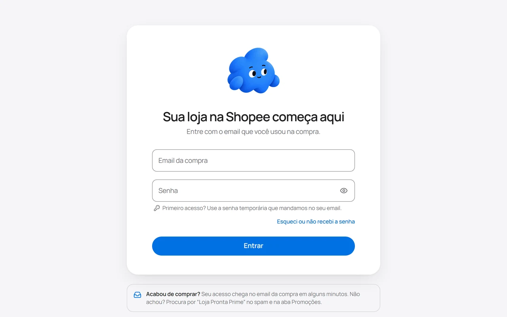
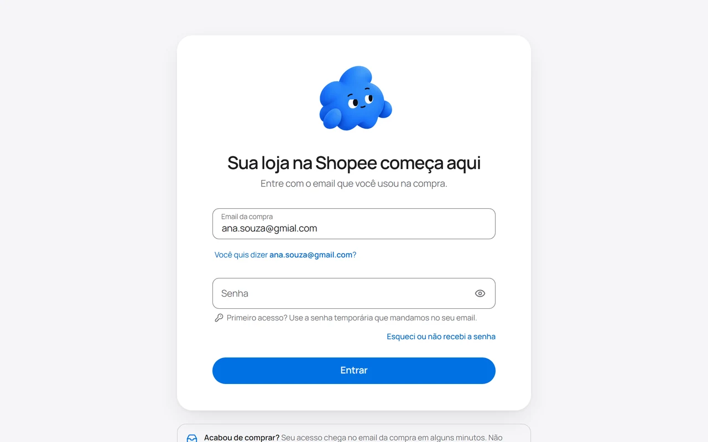
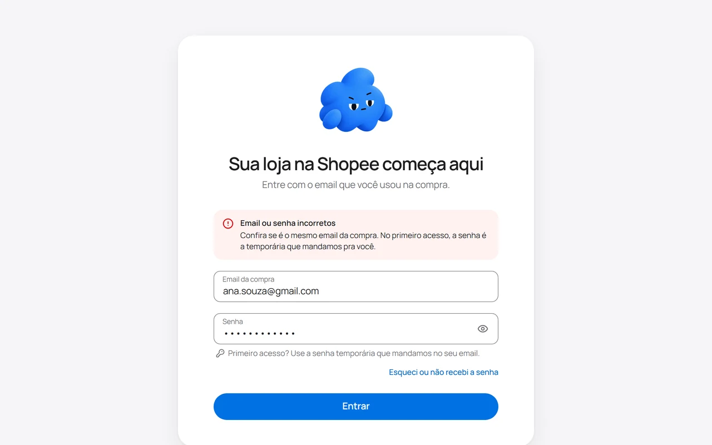
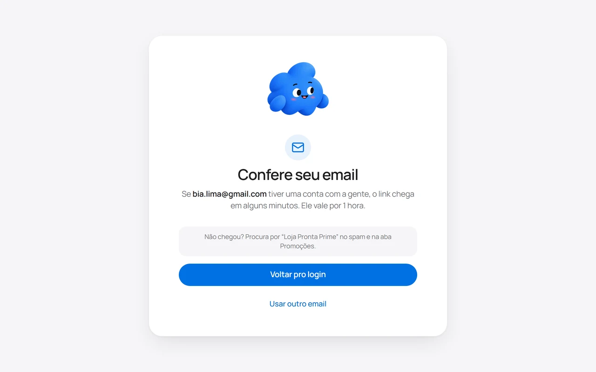
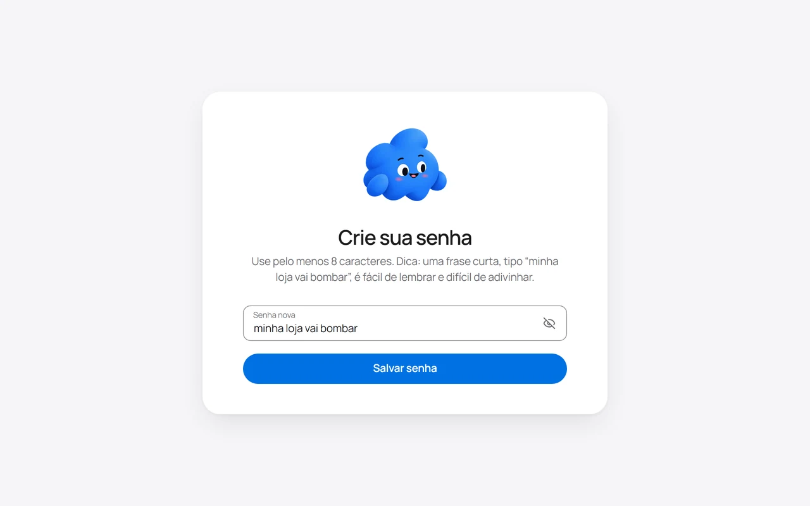
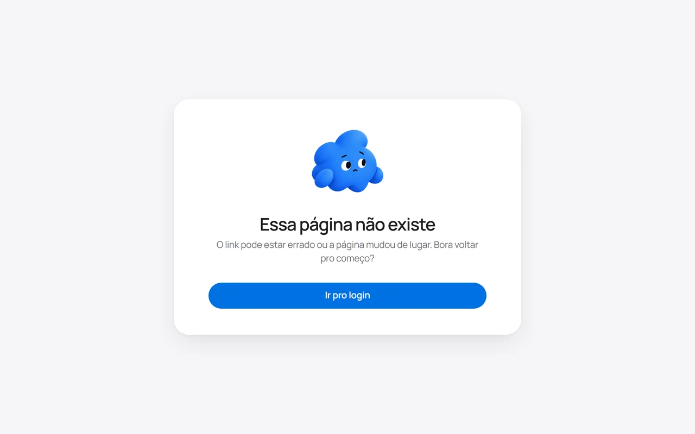
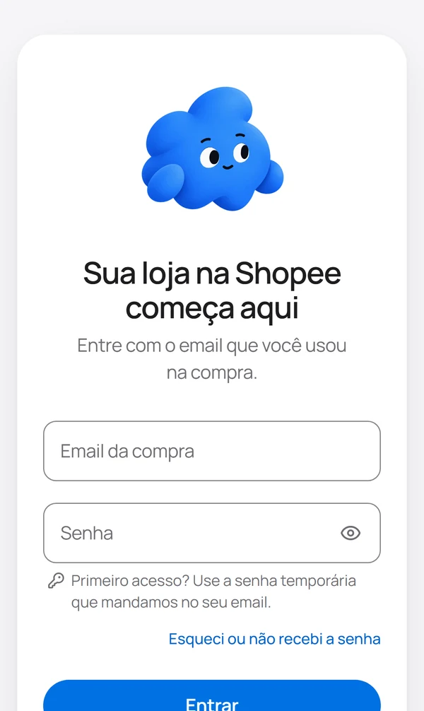
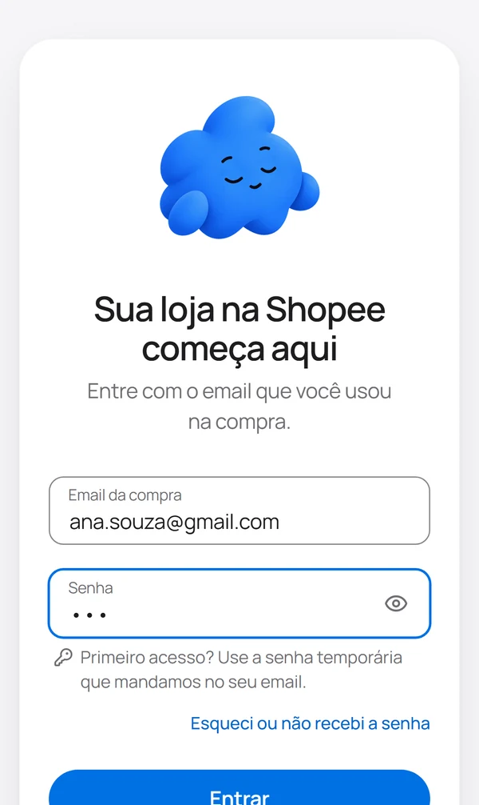
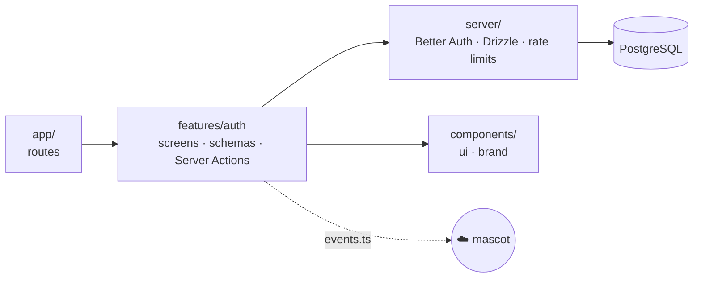
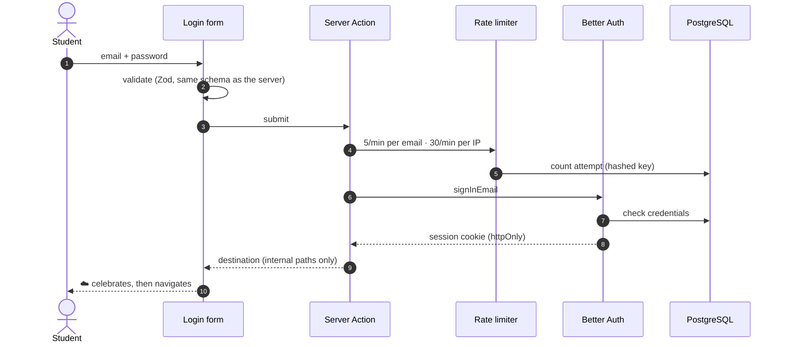

<div align="center">


# Loja Pronta Prime

**The member area where beginners learn to sell on Shopee, or follow along while our team builds their store.**

[lojaprontaprime.com](https://lojaprontaprime.com)

[](https://nextjs.org)
[](https://react.dev)
[](https://bun.sh)
[](https://www.typescriptlang.org)
[](https://tailwindcss.com)
<br />
[](https://better-auth.com)
[](https://orm.drizzle.team)
[](https://playwright.dev)
[](https://www.w3.org/TR/WCAG22/)

</div>

---

## ✨ Highlights

- 🔐 **No public sign-up.** Buying the course creates the account. Students sign in with their purchase email and a temporary password, and on their first sign-in they create a password of their own.
- ☁️ **A mascot that pays attention.** It follows the cursor, reads along as you type, covers its eyes while you type your password, and celebrates when you get in.
- 🛡️ **Secure by default.** Server-side auth, cookie sessions, per-email and per-IP rate limits, and no passwords or emails in logs.
- ♿ **Accessible.** WCAG 2.2 AA, checked by axe on every test run. Works with screen readers and the keyboard, and respects reduced motion.
- 📱 **Built for phones first.** Tested from a 320px phone up to a 1920px monitor, including phones in landscape.
- 🎨 **Apple-inspired design.** Manrope type, soft cards, floating labels and critically damped springs.

## 🖼️ Screens

<table>
  <tr>
    <td width="50%"></td>
    <td width="50%"></td>
  </tr>
  <tr>
    <td align="center"><b>Login</b> · purchase email and password, that's it</td>
    <td align="center"><b>Typo in the email?</b> · it suggests the fix</td>
  </tr>
  <tr>
    <td></td>
    <td></td>
  </tr>
  <tr>
    <td align="center"><b>Wrong password</b> · every message says what to do next</td>
    <td align="center"><b>Forgot your password?</b> · a new one in four steps</td>
  </tr>
  <tr>
    <td></td>
    <td></td>
  </tr>
  <tr>
    <td align="center"><b>New password</b> · from the link in the email</td>
    <td align="center"><b>404</b> · even the error page is friendly</td>
  </tr>
</table>

<div align="center">
  
  &nbsp;&nbsp;
  
  <p><sub>On a phone: large touch targets and inputs that don't zoom while you type.</sub></p>
</div>

## ☁️ Meet the mascot

The mascot is drawn on top of a single illustration. Its pupils, eyelids, brows and mouth are animated with springs, so every reaction is smooth and can be interrupted at any moment.

<table align="center">
  <tr>
    <td align="center"><br /><b>Happy</b><br /><sub>while you type</sub></td>
    <td align="center"><br /><b>Skeptical</b><br /><sub>email looks mistyped</sub></td>
    <td align="center"><br /><b>Eyes closed</b><br /><sub>you're typing a password</sub></td>
  </tr>
  <tr>
    <td align="center"><br /><b>Peeking</b><br /><sub>password is shown</sub></td>
    <td align="center"><br /><b>Surprised</b><br /><sub>Caps Lock is on</sub></td>
    <td align="center"><br /><b>Grumpy</b><br /><sub>wrong password</sub></td>
  </tr>
  <tr>
    <td align="center"><br /><b>Curious</b><br /><sub>follows your cursor</sub></td>
    <td align="center"><br /><b>Asleep</b><br /><sub>after 10s of inactivity</sub></td>
    <td align="center"><br /><b>Celebrating</b><br /><sub>you're in!</sub></td>
  </tr>
</table>

It knows nothing about the screens. Anything generic about a form (focus, typing, password fields, Caps Lock) it picks up on its own. Everything else arrives as an explicit signal:

```ts
import { celebrateMascot, nodMascot, setMascotDoubt, upsetMascot } from '@/components/brand/mascot';

celebrateMascot(); // a little jump of joy
upsetMascot('grumpy', alertElement); // looks at the alert, frowns and shakes its head
setMascotDoubt(true); // skeptical until set back to false
nodMascot(); // an approving nod
```

> [!TIP]
> With **reduce motion** turned on in the operating system, the mascot still changes expression, but without any animation.

<details>
<summary><b>How it's built</b></summary>

<br />

| File                                    | Responsibility                                             |
| --------------------------------------- | ---------------------------------------------------------- |
| `components/brand/mascot/mascot.tsx`    | Rendering only (illustration, eyes, brows, mouth)          |
| `components/brand/mascot/use-mascot.ts` | Behavior: combines page events into an expression and gaze |
| `components/brand/mascot/events.ts`     | Public API the screens use to talk to the mascot           |
| `components/brand/mascot/reasons.ts`    | Active reasons with priority and expiry                    |
| `components/brand/mascot/gaze.ts`       | Where to look (cursor, caret, focused element)             |
| `components/brand/mascot/face.ts`       | Expressions and mouth/brow shapes (pure functions)         |
| `components/brand/mascot/spring.ts`     | Critically damped spring                                   |

Frames are written straight to CSS variables and SVG attributes, so the animation never re-renders React.

</details>

## 🧱 Tech stack

| Layer         | Technology                                                                  |
| ------------- | --------------------------------------------------------------------------- |
| Framework     | Next.js 16 (App Router, Server Actions, Turbopack) · React 19               |
| Runtime       | Bun 1.4, used as both runtime and package manager                           |
| Auth          | Better Auth (email and password, cookie sessions, admin plugin)             |
| Database      | PostgreSQL 17 · Drizzle ORM                                                 |
| Forms         | Conform + Zod 4, with the same schema in the browser and on the server      |
| Rate limiting | Atomic per-minute counters in Postgres, with an in-memory fallback          |
| UI            | Tailwind CSS 4 · shadcn/ui (Radix) · lucide-react · Manrope and Inconsolata |
| Quality       | TypeScript (strict) · Oxlint · Prettier                                     |
| Tests         | Playwright (desktop and mobile) · axe-core                                  |

## 🏗️ Architecture

Dependencies flow one way. `server` is infrastructure and knows nothing about the screens, and the mascot knows nothing about login.



### Signing in



## 🚀 Getting started

**Prerequisites:** [Bun](https://bun.sh) 1.4+ and [Docker](https://www.docker.com). Node.js is only needed to run the tests.

```bash
bun install
cp .env.example .env.local          # then fill in BETTER_AUTH_SECRET
bun run db:up                       # Postgres 17 in Docker (port 5433)
bun run db:migrate                  # create the tables
bun run dev:aluna ana@test.com my-password-123   # create a test student (add --primeiro-acesso to
                                                 # try the first-sign-in flow)
bun run dev                         # http://localhost:3000
```

> [!NOTE]
> There is no email provider yet. In development, password reset and verification links are printed to the `bun run dev` terminal.

### Environment variables

Only infrastructure settings live here. Business settings (Hotmart, emails, copy) will be managed from the admin panel.

| Variable             | Description                                                         |
| -------------------- | ------------------------------------------------------------------- |
| `DATABASE_URL`       | Postgres connection string                                          |
| `BETTER_AUTH_SECRET` | Session secret, at least 32 characters                              |
| `BETTER_AUTH_URL`    | Public URL of the app (`https://lojaprontaprime.com` in production) |

<details>
<summary><b>Generate a secret</b></summary>

```bash
bun -e "console.log(crypto.randomUUID() + crypto.randomUUID())"
```

</details>

## 📜 Scripts

| Script                | What it does                                                                                                                                                                                                  |
| --------------------- | ------------------------------------------------------------------------------------------------------------------------------------------------------------------------------------------------------------- |
| `bun run dev`         | Development server                                                                                                                                                                                            |
| `bun run build`       | Production build                                                                                                                                                                                              |
| `bun run start`       | Production server                                                                                                                                                                                             |
| `bun run lint`        | Oxlint (`lint:fix` to fix automatically)                                                                                                                                                                      |
| `bun run format`      | Prettier                                                                                                                                                                                                      |
| `bun run typecheck`   | `tsc --noEmit`                                                                                                                                                                                                |
| `bun run db:up`       | Start the development Postgres (`db:down` to stop it)                                                                                                                                                         |
| `bun run db:generate` | Generate a migration from the Drizzle schema                                                                                                                                                                  |
| `bun run db:migrate`  | Apply migrations                                                                                                                                                                                              |
| `bun run db:studio`   | Open Drizzle Studio                                                                                                                                                                                           |
| `bun run auth:schema` | Regenerate the Better Auth tables schema                                                                                                                                                                      |
| `bun run dev:aluna`   | Create a test student: `<email> <password> [--nao-confirmada] [--desativada] [--primeiro-acesso] [--so-sll \| --so-loja-pronta \| --sem-produto] [--fase=<1-7>]` (both products and store phase 1 by default) |
| `bun run test`        | Unit tests (Bun's built-in runner, `*.test.ts` under `src/`)                                                                                                                                                  |
| `bun run test:e2e`    | End-to-end tests (`test:e2e:ui` for the visual runner)                                                                                                                                                        |

## 🧪 Testing

The end-to-end suite runs against the real app and database, on desktop Chrome and on a Pixel 7. It covers:

- **Login, first sign-in, recovery and reset flows**, including open-redirect attempts and rate limits stored in the database.
- **The area chooser and both product areas**, including the Loja Pronta first conversation: every question type, resuming, editing from the review, keyboard use and the flow with JavaScript turned off.
- **Security:** Better Auth's HTTP sign-in and reset endpoints stay disabled.
- **The mascot's reactions**, including reduced motion.
- **Layout** on phones, phones in landscape and 320px screens.
- **Accessibility:** WCAG 2.2 AA checks with axe, keyboard order and focus visibility.

Test students are created before each run and removed after it.

Pure rules (like the conversation's answer validation) also have unit tests, which run in milliseconds and need no database: `bun run test`.

```bash
bun x playwright install chromium   # first time only
bun run db:up                       # the database must be running
bun run test:e2e                    # starts `bun run dev` if it isn't running
```

> [!NOTE]
> The Playwright runner uses **Node.js**, not Bun: its CLI starts with `#!/usr/bin/env node` and `bun run` respects that, since Playwright doesn't officially support the Bun runtime. The app under test still runs on Bun.

## 🛡️ Security

> [!IMPORTANT]
> Authentication always happens on the server, and the session lives in an `httpOnly` cookie.

- **Passwords** are never sent back in server responses and never logged.
- **Password recovery** never reveals whether an email has an account: the response and the response time are the same either way.
- **Rate limits** apply per email (protecting each account) and per IP (stopping one password from being tried across many accounts). Only hashes are stored.
- **Better Auth's HTTP sign-in and reset endpoints are disabled,** so the rate-limited Server Actions are the only way in.
- **The post-login redirect** accepts internal paths only (protection against open redirects).
- **The client IP** comes from the proxy's own `X-Forwarded-For` entry, which clients cannot spoof.

## 📁 Project structure

```text
docs/                    Product and Hotmart integration notes (Portuguese)
e2e/                     Playwright end-to-end tests
drizzle/                 Generated migrations (don't edit by hand)
scripts/                 Development scripts
src/
├─ app/                  Routes (App Router); /api/auth/* belongs to Better Auth
├─ components/
│  ├─ brand/             Logo, card and page shell for the access screens
│  │  └─ mascot/         Mascot: rendering, behavior and signals (events.ts)
│  └─ ui/                shadcn/ui components adapted to the theme
├─ features/
│  ├─ auth/              Access screens: components, schemas and messages
│  │  └─ server/         Server Actions and server-side rules
│  ├─ onboarding/        Loja Pronta first conversation (questions, review, WhatsApp)
│  │  └─ server/         Answers storage and Server Actions
│  └─ products/          Area chooser and product areas (SLL, Loja Pronta)
│     └─ server/         Which products each student has, page access rules
├─ config/               Access rules and validated environment (Zod)
├─ lib/                  Utilities (cn, search params)
├─ server/               Server infrastructure: auth, database, request
└─ types/                Type declarations (imported images)
```

## 🤝 Contributing

- **Branches:** one per change (`type/short-description`), merged into `main` through a pull request.
- **Commits:** atomic, in English, following [Conventional Commits](https://www.conventionalcommits.org) (`feat(auth): …`, `fix(ui): …`, `test(e2e): …`). Each commit passes `typecheck` and `lint` on its own.
- **Before opening a PR:** run `bun run lint`, `bun run typecheck`, `bun run test` and `bun run test:e2e`.
- **Package manager:** use only `bun` and `bun x`, never npm, npx, yarn or pnpm.

## 📚 Documentation

- [Product overview](docs/PRODUTO.md) (Portuguese)
- [Hotmart integration](docs/INTEGRACAO-HOTMART.md) (Portuguese): vision, decisions and next steps.

---

<div align="center">
  
  <br />
  <sub>Private and proprietary. © Loja Pronta Prime. All rights reserved.</sub>
</div>
